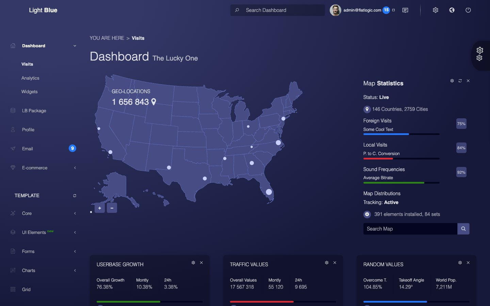

# Light Blue HTML5

A free Bootstrap 4 dashboard with transparent widgets, two color themes and 53 HTML pages. The dashboards, forms, tables, charts and calendar run in the browser with sample data. Gulp compiles the pages from Handlebars templates and Sass.

[Live demo](https://flatlogic.com/templates/light-blue-html5/demo) · [Download the latest release](https://github.com/flatlogic/light-blue-html5/releases/latest) · [Changelog](changelog.md)



## Run locally

The release was tested with Node.js 22 and Yarn Classic 1.22.22. From a terminal, clone the project, install the locked dependencies and build the dashboard.

```sh
git clone https://github.com/flatlogic/light-blue-html5.git
cd light-blue-html5
npx --yes yarn@1.22.22 install --frozen-lockfile
npm run build
python3 -m http.server 8000 --bind 127.0.0.1
```

Open [the dashboard](http://127.0.0.1:8000/dist/dashboard/index.html). Start the HTTP server from the repository root so pages under `dist/` can load their browser libraries from `node_modules/`. For static hosting, preserve the same relative paths for the pages and the browser assets they reference.

## Work on the template

| To change | Edit | See it in the browser |
| --- | --- | --- |
| Dashboard widgets | `src/pages/dashboard/` and `src/js/dashboard/` | [Visits dashboard](http://127.0.0.1:8000/dist/dashboard/index.html) |
| Shared navigation | `src/partials/sidebar.hbs` and `src/partials/layout.hbs` | Sidebar on every dashboard page |
| Form validation and editors | `src/pages/form/` and `src/js/form/` | [Validation](http://127.0.0.1:8000/dist/form/form_validation.html) |
| Tables, charts and calendar | `src/pages/` and `src/js/` | [Tables](http://127.0.0.1:8000/dist/tables/tables_dynamic.html) · [Charts](http://127.0.0.1:8000/dist/charts/charts.html) · [Calendar](http://127.0.0.1:8000/dist/extra/calendar.html) |
| Colors and typography | `src/sass/` | Default and dark stylesheets in `dist/css/` |

Use `npm run watch` in a second terminal to rebuild as you edit. Use `npm run build` for a regular build. To regenerate the entire distribution, run `npx --yes yarn@1.22.22 gulp` from the repository root. This clears `dist/` first, so keep your edits under `src/`.

## Upgrading from 4.6.x

Run a fresh install with the lockfile before rebuilding. The standalone D3 examples now use D3 7 in their own bundle. Rickshaw and NVD3 keep their original D3 3 API. If you customized the standalone charts, use `window.lightBlueD3` on that page.

Markdown preview uses markdown-it with raw HTML disabled. The payment wizard uses a native month input for card expiration. The Morris charts use the upstream build with escaped hover labels, pinned to a reviewed commit.

## Upgrading from 4.5.x

Version 4.6 uses jQuery 3.8.0 in the browser and Handlebars 4.7.10 for the build. Update the sources and lockfile together, reinstall with the command above and rebuild. The template now handles mobile swipes with Hammer directly. If you have custom scripts that call `$.fn.hammer`, update those calls before publishing your copy.

## License and community

Light Blue HTML5 is available under the [MIT license](LICENSE). For related dashboards, see [Light Blue Angular](https://github.com/flatlogic/light-blue-angular), [Light Blue Vue](https://github.com/flatlogic/light-blue-vue) and [Flatlogic templates](https://flatlogic.com/templates). Join the [Flatlogic community](https://discord.gg/flatlogic-community) or [report an issue](https://github.com/flatlogic/light-blue-html5/issues).
